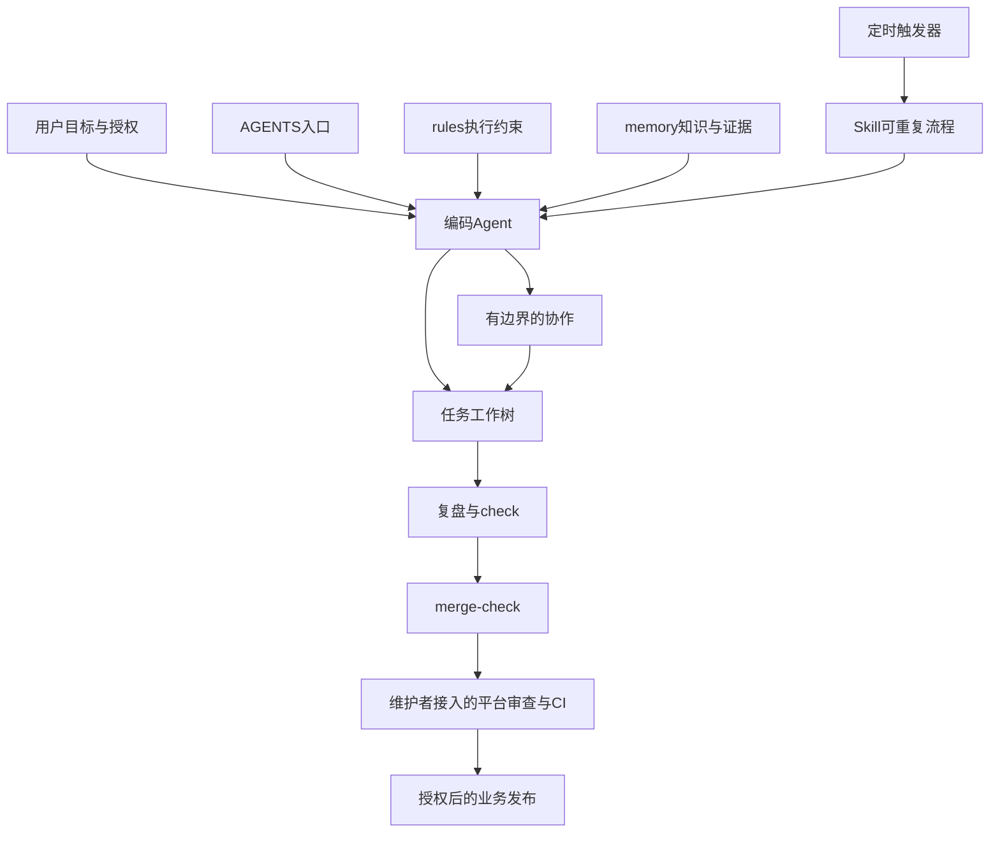

# 架构与机制边界

这个模板管理编码Agent如何接手、执行与交付，不是业务Agent运行时。文件知识由当前Agent按入口读取，Node工具做确定性检查，没有后台模型调用或训练。

## 分工

| 层 | 内容 | 不承担 |
|---|---|---|
| rules | 授权、隔离、验证、协作约束 | 项目事实和第二份步骤 |
| memory | 稳定事实、偏好、设计选择、工程教训 | 完整历史、私有数据和永久指令 |
| Skill | 触发、输入输出、执行及失败流程 | 扩大授权或定时器本身 |
| 工程CLI | 字段/链接/变动关联/指纹检查 | 证明自然语言真实、有价值 |
| 平台适配 | CI、保护分支、MR与部署 | 由本模板默认提供管理员授权 |

## 交付关联

任务复盘关联分支、基线与源码指纹，声明memory和Skill处理结果，能力启用时带CLI影响审查。验收生成当前指纹的摘要；merge-check检查洁净、已提交回执及新鲜验证。内容或基线变动后重验，避免旧结果为新代码背书。

文件记忆的active表示当前适用并有来源，不表示所有事实都经机器核实；user-reported与test-verified应明确区分。失效通过pending、superseded、revoked管理，不默默删除。

能力快照只保证配置所声明的来源未漂移，不能替代任意语言API静态分析。定时守卫只检查显式提供的配置，不读取所有平台配置。平台merge和生产release属于接入能力，第一版只有本地合并前检查与发布计划插口。

## 避免机制膨胀

任务复盘可以none；重复价值不足可以defer。Skill优先更新同主题，按需加载长参考。主代理审查证据与实际diff，子代理只返回候选。一次性执行结果与私有日志留在运行目录。历史蒸馏若以后引入，应先定义来源授权、候选去重、重新核验与发布范围，不能把对话批量转成active知识。
